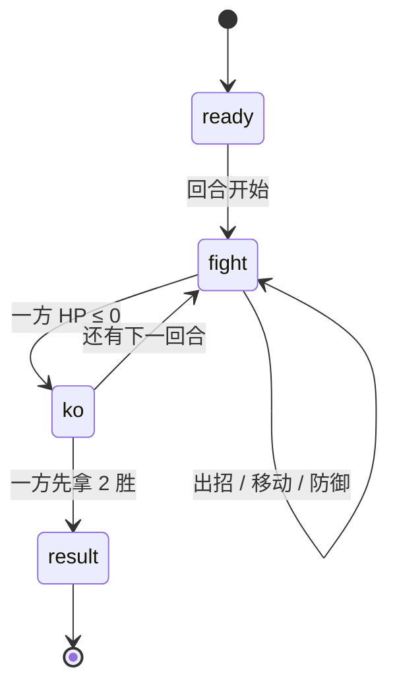
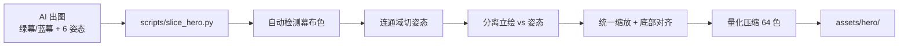

# 抽象梗格斗 · 设计方案

> 项目代号 `fighter`，第二款游戏。定位：**横屏 1v1 横版格斗**，抖音网络抽象梗英雄，单机可玩 + 后续联网。
> 首期只做 3 位英雄：**牛来 / 咕咕嘎嘎 / 奶娃**。

---

## 1. 为什么做这个

第一款游戏「跳跳小光」已经跑通「开发 → 提审 → 上线 → 广告变现」全链路，但它是个纯手感小游戏，留存和话题性都有限。

抽象梗格斗的差异点：

| 维度 | 跳跳小光 | 抽象梗格斗 |
|---|---|---|
| 用户动机 | 打发时间 | 认梗、玩梗、截图分享 |
| 传播方式 | 靠分享复活 | 角色本身自带传播（「这游戏有牛来」） |
| 留存钩子 | 最高分 | 解锁角色、段位、连招 |
| 变现弹性 | 复活广告 | 复活 + 双倍奖励 + 解锁角色 + 皮肤 |

梗自带流量，是这个项目真正的低成本获客手段。

---

## 2. 英雄设定（首期 3 位）

三位英雄共用一套核心战斗规则，差异靠**数值修正 + 大招机制**体现，不做完全独立的连招表 —— 首期人力不允许，而且格斗游戏真正的深度来自通用规则的博弈。

| key | 名字 | 梗来源 | 定位 | HP | 移速 | 特点 | 大招 |
|---|---|---|---|---|---|---|---|
| `niu` | 牛来 | 小牛喊「妈妈——」 | 力量型 | 115 | 2.8 | 重拳伤害 ×1.25，前摇长但压制强 | **「妈妈——」**：前方锥形声波，一击 38 伤害 + 击退 110 |
| `gu` | 奶娃 | 抱肚子笑 + 魔性笑声 | 控制型 | 100 | 3.4 | 受击回能 +40%，大招来得快 | **魔性笑声**：持续 60 帧范围场，每 10 帧 6 伤害并使对手硬直 |
| `nai` | 咕咕嘎嘎 | Pigeon Pop 鸽群 | 速度型 | 90 | 4.0 | 轻拳前摇 3 帧（最快），可抢帧 | **鸽群弹幕**：3 段远程投射，每段 12 伤害 |

> `HeroKey`（`niu`/`gu`/`nai`）与美术资源文件名绑定，**永不随显示名变化**；改名字只改 `heroes.ts` 的 `name` 字段。

### 2.1 侵权的处理

「牛来」「奶娃」这类名字如果直接对应到具体影视/短视频角色，存在被判定「蹭 IP」的风险。当前按你的要求**保留原名**，但代码层面做了隔离：

- 资源 key 用 `niu` / `gu` / `nai`，不是原名
- 角色显示名集中在 `src/core/heroes.ts` 一处，改名只改一行
- 提审前如果被驳回，直接换成 `牛犇犇 / 鸽斯拉 / 奶嗝娃`，不需要动资源

---

## 3. 战斗系统

### 3.1 核心循环



### 3.2 帧数据（60fps）

一次出招 = **前摇 → 判定 → 后摇**，只有判定帧能命中。

| 招式 | 前摇 | 判定 | 后摇 | 总帧 | 伤害 | 段数 | 射程 | 击退 | 硬直 | 回能 |
|---|---|---|---|---|---|---|---|---|---|---|
| 轻拳 | 5 | 3 | 7 | 15 (250ms) | 7 | 1 | 95 | 12 | 11 | 8 |
| 重拳 | 13 | 4 | 16 | 33 (550ms) | 16 | 1 | 110 | 34 | 20 | 12 |
| 大招 | 22 | 10 | 26 | 58 (970ms) | 34 | 1 | 190 | 90 | 40 | 0 |

- 前摇期间被打 → 招式取消（counter hit），这是格斗游戏的核心博弈
- **多段招**：招式可覆盖 `hits` / `hitInterval` / `active` / `hitStun`，判定窗内每 `hitInterval` 帧落一段，最多 `hits` 段。目前只有大招用到：
  - 奶娃「魔性笑声」（`gu`）：`active 60 / hits 6 / interval 10 / hitStun 12` → 6 段 × 6，硬直刻意压到 12 帧，避免无限锁
  - 咕咕嘎嘎「鸽群弹幕」（`nai`）：`active 10 / hits 3 / interval 3` → 3 段 × 12
  - 牛来「妈妈——」保持单段 38，走「一击重」路线
- 只有第一段算 counter hit（1.2 倍），后续段不叠加，防止多段招爆发失控
- 出招有代价：后摇期间不能行动

### 3.3 防御

- 按住防御键：伤害 ×0.15，硬直减半，**不回能**
- 防御中不能移动、不能出招
- 重拳打防御仍有 34×0.15 ≈ 2.4 伤害，逼迫对手不能纯龟

### 3.3.1 击退

击退以初速度形式加到受击方的 `pushback` 上，之后每帧 `x += pushback`、`pushback *= 0.3`，衰减到 0.6 以下归零。重拳 `knockback=34` 实测净位移约 **60px**（约 1/4 屏幕宽度），3~4 帧内推到位，够看出「打退」但不至于把对手弹出镜头。衰减系数写在 `battle.ts` 的 `decayTimers` 里，改它等于改全局手感，需同步 `test/battle.test.ts` 的「重拳击退把对手整体推开一段可见距离」。

### 3.4 能量与连击

- 能量 0~100，造成伤害和受到伤害都涨（受击方涨得更多，落后方有翻盘机会）
- 满 100 才能放大招，放完清零
- 连击：命中后 40 帧内再命中 +1 combo，每层伤害 +8%，封顶 +40%
- 连击数在 HUD 上大字显示，是截图传播的关键点

### 3.5 回合

- 三局两胜，单回合 60 秒
- 时间到按剩余 HP 百分比判胜，相同则判平局
- 平局**双方各记一分**，避免双方都不掉血时无限打平
- 回合数硬上限 `MAX_ROUNDS = 5`，到顶就按剩余血量比例决出胜负
- 回合间有 90 帧的 KO 演出

---

## 4. 操作设计

**横屏**布局，双手拇指托底：左手走位、右手出招。

```
┌───────────────────────────────────────────────────────────┐
│ 牛来 ███████░░░░        ⏱ 47        ░░░███████ 咕咕嘎嘎  │ ← HUD
│ ⚡ 68                                              ⚡ 32  │
├───────────────────────────────────────────────────────────┤
│                                                           │
│        🐂                              🐧                 │ ← 舞台（1280 宽，固定机位）
│   ══════════════════════════════════════════════════      │
│                                                           │
│  ← →                                       大招  重拳     │ ← 操作区
│                                            盾    拳       │
└───────────────────────────────────────────────────────────┘
```

- **左下**两个方向键（不是摇杆 —— 格斗只需要前后移动，按键判定更精确）
- **右下** 2×2 四键，下排「盾 / 拳」、上排「大招 / 重拳」，上排半径略小以免压住角色头部
- 大招未满能量时按钮置灰并显示所需能量
- 支持多点触控（移动 + 出招可以同时按）
- 手指按在空白处按「左半屏 / 右半屏」自动接管走位，滑过中线换向，不会点空

**为什么不做跳跃**：跳跃会引入空中判定、对空、空投等一整套复杂度，首期收益不抵成本。地面战已经够好玩，后续版本再加。

### 4.1 自适应横屏

抖音/微信新机型几乎都是 19.5:9 甚至更宽，屏幕比例不统一。策略是**高度锁死、宽度按比例外扩**：

| 环节 | 做法 |
|---|---|
| 基准舞台 | `STAGE_W = 1280`、`STAGE_H = 720`、地面 `GROUND_Y = 560` |
| 缩放 | `fitScale = min(vpW / 1280, vpH / 720)`，高度优先铺满 |
| 逻辑视图 | `view.h` 恒为 720，`view.w = max(1280, vpW / scale)`（16:9 → 1280，19.5:9 → ~1560） |
| 战斗世界 | 1280 宽**固定居中**，左右余量用 `stageOffsetX(view)` 补；`stage.ts` 一次 `ctx.translate` 统一平移 |
| 菜单界面 | `contentBox(view)` 把标题/选人/结算收进中央 1280 内容区，元素尺寸不随屏幕变宽 |
| 操作键 | 用 `view.w` 定位、贴真正的屏幕四角，大屏手指也够得到 |
| 多余留白 | 4:3 平板会上下留黑边，`main.ts` 的 `offsetX / offsetY` 在 `setTransform` 里补偿，`toLogical()` 反算回去 |

这套策略的好处：**逻辑坐标只有一套**，`battle.ts` / `ai.ts` 完全不知道屏幕多大，单测只要给一个 1280×720 的 `View` 就能跑；同时手机越宽可视范围越大，不会出现「两边被裁掉」。

---

## 5. 单机 AI

分层状态机，不做机器学习。每帧按固定优先级做一次决策：

1. **防御**：血量低于 45% 且距离 < 260，按 `blockBias` 概率防御
2. **大招**：能量满且距离 < 300，按 `ultimateEagerness` 概率放
3. **出招**：`gap < lightReach * 0.92` 时按 `aggression` 掷轻/重拳；`gap < heavyReach * 0.95` 时只掷重拳
4. **走位**：把距离拉向 `wantGap = lightReach * preferredGap`，进入 `[0.55×, 1.15×]` 静止带就停步；每段走位保持 6~13 帧防抖

难度参数（三档）：

| 档位 | 反应延迟 | 出招概率 | 防御概率 | 能量利用率 | 目标距离 |
|---|---|---|---|---|---|
| 简单 | 14 帧 | 0.012 | 0.25 | 0.2 | 0.78 |
| 普通 | 8 帧 | 0.03 | 0.45 | 0.55 | 0.66 |
| 困难 | 4 帧 | 0.055 | 0.6 | 0.85 | 0.55 |

「反应延迟」用环形缓冲实现：AI 看到的是 N 帧前的战场状态。这是让 AI 显得「像人」而不是「开挂」的关键。

**目标距离必须落在射程内。** `preferredGap` 的单位是「轻拳射程（含身体半径）的倍数」，取值必须让静止带上沿 `wantGap * 1.15` 小于出招阈值 `lightReach * 0.92`，否则 AI 会站在打不到的位置一动不动。这条约束由 `test/ai.test.ts` 的「AI 会主动进攻」用例守住。

---

## 6. 联网 1v1（第二期）

### 6.1 选型

| 方案 | 优点 | 缺点 | 结论 |
|---|---|---|---|
| 帧同步（Lockstep） | 流量极小，完全公平 | 需要严格确定性，回滚复杂 | 格斗游戏正解，但首期做不完 |
| 状态同步 | 实现简单 | 延迟手感差，易被改包 | 首期过渡用 |

**结论**：第二期先做**状态同步 + 客户端预测**，验证留存；如果数据好再做帧同步重写。

### 6.2 门槛

- 微信小游戏要求 WebSocket 域名**已备案**，且备案主体与小游戏主体一致
- 当前只备案了小游戏，需要**新增小程序备案**（或补备案域名）
- 服务器：一台 2C4G 轻量云 + Node + `ws` 足够撑早期 DAU
- 预算：约 ¥100/月

### 6.3 反作弊

格斗游戏天然适合服务器权威：服务器只跑战斗逻辑（纯函数，和客户端同一份代码），客户端只发输入。

---

## 7. 变现（IAA）

| 点位 | 触发 | 频次上限 | 预估 eCPM |
|---|---|---|---|
| 复活 | 单局失败后 | 每局 2 次 | ¥35 |
| 双倍结算 | 胜利后 | 每日 3 次 | ¥30 |
| 解锁角色 | 想换英雄 | 每位 1 次 | ¥45 |
| 皮肤 | 图鉴页 | 不限 | ¥25 |

**关键约束（审核红线）**：

1. 广告必须是**可选**的，不能强制观看才能继续
2. 结束页不能出现「调试模式」等内部字样（第一款游戏踩过这个坑）
3. 广告按钮要明确标注「看视频」，不能伪装成普通按钮
4. 未成年人保护、健康游戏忠告必须到位

---

## 8. 技术架构

```
games/fighter/
├── src/
│   ├── core/            纯逻辑，零 Canvas 依赖，可单测
│   │   ├── constants.ts 舞台尺寸、帧率、回合参数
│   │   ├── heroes.ts    3 位英雄的数值修正（改名只改这里）
│   │   ├── moves.ts     帧数据表
│   │   ├── battle.ts    战斗状态机（step 纯函数）
│   │   └── ai.ts        分层 AI（含反应延迟环形缓冲）
│   ├── core/
│   │   └── view.ts      自适应横屏：fitScale / stageOffsetX / 屏幕↔舞台坐标换算
│   ├── render/
│   │   ├── stage.ts     舞台、地面、角色精灵
│   │   ├── hud.ts       HP 条、能量条、连击、倒计时
│   │   ├── menu.ts      标题 / 选人 / 结算三页
│   │   ├── pad.ts       2×2 四键操作区
│   │   ├── fx.ts        命中特效（光晕 + 星形 + 星屑）
│   │   └── draw.ts      公共绘制工具
│   ├── platform/        wx / tt / web 三端适配（复用 jump）
│   ├── config.ts        广告位 ID
│   └── main.ts          主循环、输入、场景切换
├── assets/hero/         切好的英雄帧（{key}_sheet_0..5.png + {key}_bust.png）
├── assets/hero_raw/     AI 原始出图（不入构建）
├── scripts/             build / dev / upload / shot / slice_hero.py / measure_hero.py
└── test/                逻辑与 AI 行为测试（44 项）
```

### 8.1 为什么全自研不引引擎

和第一篇选型一致：包体小、启动快、逻辑可控。格斗游戏的渲染需求只是「画几张图 + 血条」，用不上引擎。

预计包体：**< 900KB**（素材 912KB 是未压缩 PNG，构建时转 base64 内联或走图集还能再降）。

### 8.2 打击反馈

格斗游戏的「手感」一大半来自命中瞬间的表现。当前实现三层叠加：

| 层 | 实现 | 效果 |
|---|---|---|
| 闪白 | `stage.ts` 的 `fighter.flash` | 被打一方整只角色染白 4 帧 |
| 震屏 | `battle.shake` → `drawHitFx` 平移画布 | 伤害 ×0.6，锁在 6~22px |
| 粒子 | `render/fx.ts` | 光晕 + 尖角星 + 星屑 + 闪光环 |

`fx.ts` 的设计要点：

- **主爆点用代码画，不用贴图**。素材包的 `slash_*` / `spark_*` 不透明像素只有 5%~11%，
  放大后依旧「薄」，实测画面变化仅 5%。改成径向渐变光晕 + 16 点星形后升到 17%~29%。
- 贴图只做外围星屑与装饰，缺图不影响主表现（`drawImage` 全部包 `try/catch`）。
- `Burst.stageY` 存**舞台坐标**，绘制时才 `toScreenY`，避免分辨率变化时特效跑位。
- 力度用 `radius` 区分：轻拳 46 / 重拳 64 / 大招 96。
- 存活 22 帧，前 8 帧放大到顶，之后线性淡出。

### 8.3 素材流程



`slice_hero.py` 的能力：

- 自动判断绿幕 / 蓝幕 / 纯色底（边框采样，`excess = ch - max(others)`）
- 软边 alpha + despill，消掉边缘那圈绿
- 连通域切分，**不假设等分网格** —— AI 出图布局经常是「左立绘 + 右 6 姿态」
- 立绘识别：宽度 > 30% 图宽 且位于左半区
- 统一 scale（保留各姿态相对大小）+ 底部对齐
- 调色板量化，单帧 ~30KB

---

## 9. 里程碑

| 阶段 | 内容 | 交付 |
|---|---|---|
| M1 | 素材 + 战斗核心逻辑 + 单测 | `battle.ts` / `ai.ts` 全绿 |
| M2 | 渲染 + 输入 + 三端适配 | 浏览器可玩 |
| M3 | HUD / KO 演出 / 结算 | 完整单局体验 |
| M4 | 广告接入 + 提审材料 | 可上传 |
| M5（二期） | 联网 1v1 | 需先备案 |

M1~M4 目标 **2 周内**完成提审。

---

## 10. 风险

| 风险 | 影响 | 应对 |
|---|---|---|
| 角色 IP 侵权被判 | 提审驳回 / 下架 | 名字/立绘集中在 `heroes.ts`，被驳回 1 小时内可换名换图 |
| 格斗品类的审核更严（涉暴力） | 驳回 | 走「抽象梗打闹」路线，不做流血/写实，伤害用星星和数字表现 |
| 帧数据失衡（某一角色过强） | 劝退 | 单测覆盖每个招式的时间窗，先做数值模拟再上线 |
| 联网备案拖期 | 二期延期 | 一期先不做联网，单机 AI 撑留存 |
| 素材风格不统一 | 观感差 | 已用「同一风格锚定图 + 参考图」流程出图 |

---

## 11. 提审要点（沿用第一款经验）

- [ ] `debugFakeAd: false`
- [ ] 广告位 ID 真实且已开通流量主
- [ ] 游戏名称与后台一致
- [ ] 健康游戏忠告 + 适龄提示
- [ ] 截图 ≥ 3 张，含核心玩法
- [ ] 无「调试」「测试」等字样
- [ ] 未成年人保护弹窗

详见 [docs/WECHAT.md](../../docs/WECHAT.md) 的 `5B` 章节。
